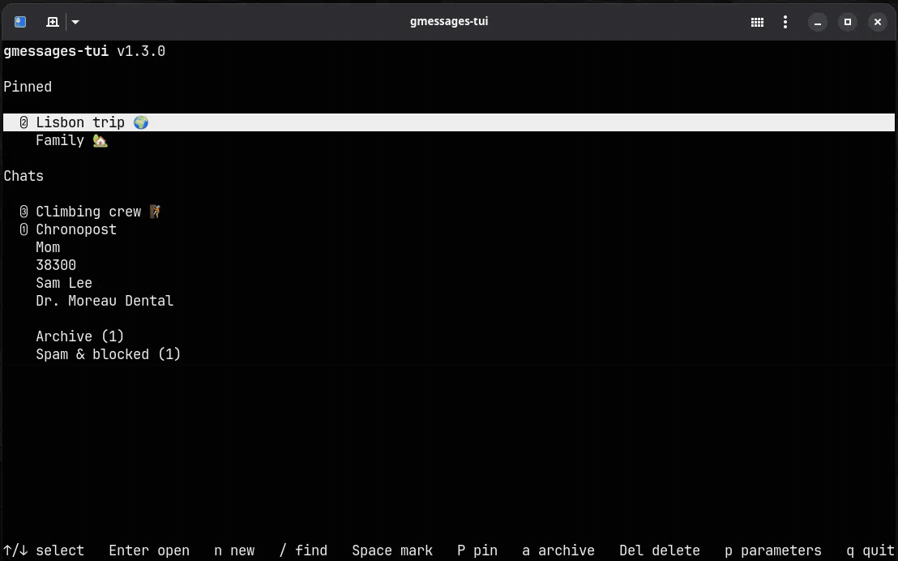

# gmessages-tui

**Google Messages (RCS and SMS) in your terminal.** Pair it with your Android phone, the way Google Messages for web does, and read and answer your texts without leaving the terminal.



- **Native, not a wrapped web page**: a Rust program speaking the Google Messages for web protocol itself, through [gmessages-proto](gmessages-proto/), a library written for it.
- **Images in the terminal**: thumbnails inline (kitty graphics protocol), pasted with `Ctrl+V`, opened full size with `o`.
- **The whole phone**: inbox, archive, spam and trash folders kept in sync both ways; new chats with contacts or numbers, groups; read state, typing, desktop notifications; messages not sent shown as on the phone, with resend.
- **Keyboard first**: fuzzy `:emoji` picker, search across chats and messages ignoring accents, pinned chats, batch actions.
- **Offline reading**: history in a local store encrypted with SQLCipher, its key in the OS keyring.

Built on the protocol work of [mautrix-gmessages](https://github.com/mautrix/gmessages) and its library [libgm](https://github.com/mautrix/gmessages/tree/main/pkg/libgm), by Tulir Asokan and the mautrix contributors: they reverse-engineered Google Messages for web, and this project would not exist without them.

**Not affiliated with Google.** Google Messages is a trademark of Google LLC.

## Quick start

Needs Rust ≥ 1.89 and the OpenSSL development package (Fedora: `openssl-devel`, Debian/Ubuntu: `libssl-dev`). On Linux, the sign-in window also needs GTK 3 and WebKitGTK 4.1 (Fedora: `gtk3-devel webkit2gtk4.1-devel`, Debian/Ubuntu: `libgtk-3-dev libwebkit2gtk-4.1-dev`).

```sh
cargo install --locked --git https://github.com/louisrubet/gmessages-tui
gmessages-tui
```

First run: sign in to the phone's Google account in the window that opens, then tap on your phone the emoji shown in the terminal. That's it: your conversations come in.

Add `--no-default-features` to the install for a headless build without the sign-in window (pairing by pasting from a browser, see [options](#pairing-and-options)). From a checkout: `cargo install --locked --path .`.

## How it works

```
gmessages-tui  ──HTTPS──▶  Google's relay (as messages.google.com)  ◀──▶  Google Messages on your phone
```

Google Messages has no public API. Like Google Messages for web, gmessages-tui never talks to the phone directly: both talk to a Google relay. The phone holds the messages and sends them, so **it must stay online**.

- Everything exchanged with the phone is encrypted with keys shared at pairing; media are encrypted per file.
- No third-party server: gmessages-tui talks only to Google, as the web client does.
- The protocol is documented in [doc/protocol/](doc/protocol/): a specification written from the analysis of [libgm](https://github.com/mautrix/gmessages/tree/main/pkg/libgm), the Go library of the mautrix-gmessages Matrix bridge, whose authors discovered it.
- [gmessages-proto](gmessages-proto/) implements it in Rust from that specification alone (a clean-room implementation, without libgm's code). It is a reusable library, AGPL-3.0 like the rest.
- The interface is [chat-tui](https://github.com/louisrubet/chat-tui), shared with [signal-tui](https://github.com/louisrubet/signal-tui), a Signal client built the same way.

## FAQ

- **iPhone?** No: Google Messages for web, and so gmessages-tui, need Google Messages on an Android phone.
- **Is it official?** No. It uses the same undocumented API as messages.google.com; Google may change it at any time, and its terms of service apply. Use at your own risk.
- **Does my phone need to be on?** Yes, and online: it sends and receives everything, as with the web client.
- **Where do my messages go?** From your phone to your terminal, through Google's relay, as with messages.google.com. Locally, they are kept in an encrypted store (see [Security details](#security-details)).
- **What is out of scope?** Calls, stickers, and recording voice messages.

## Pairing and options

`gmessages-tui --reset-login` forgets the pairing and starts over. Also remove the old device from your phone (*Device pairing*).

`gmessages-tui --manual` pairs from a page in your browser, when the window is unavailable or refused by Google (Firefox private window, Developer tools › Network › `config` › *Copy as cURL*, paste). `gmessages-tui --qr` pairs by QR code, for phones that still offer it.

`gmessages-tui --version` prints the release version, `gmessages-tui --help` the options.

## Uninstall

```sh
gmessages-tui --uninstall        # store key in the keyring, ~/.local/share/gmessages-tui, ~/.cache/gmessages-tui
cargo uninstall gmessages-tui    # the program
```

`--uninstall` asks for confirmation. Also remove the device from your phone (*Device pairing*).

## Terminal

Any terminal works. For thumbnails, use one that speaks the [kitty graphics protocol](https://sw.kovidgoyal.net/kitty/graphics-protocol/) **with Unicode placeholders**:

| Terminal | Linux | macOS | Windows |
|---|:-:|:-:|:-:|
| [Ghostty](https://ghostty.org) (recommended) | ✓ | ✓ | |
| [kitty](https://sw.kovidgoyal.net/kitty/) | ✓ | ✓ | |
| [Rio](https://rioterm.com) | ✓ | ✓ | ✓ |

On Windows, Rio is the only native option; kitty also runs under WSL with WSLg.

Elsewhere (WezTerm, Konsole, iTerm2, Warp, Windows Terminal, Alacritty, inside tmux…) everything works but graphics are reduced: images show as `[image #1]` and open full size with `o`.

## Keys

| Key | Action |
|---|---|
| `↑` `↓` | select chat / message (in a chat, `↑` starts selecting) |
| `Enter` | open chat, new message, send |
| `r` | reply to the selected message |
| `e` | react to the selected message: `1`–`6` for the usual ones, or type a shortcode |
| `f` | forward the selected message |
| `c` | copy the selected message (OSC 52) |
| `o` | open the links and images of the selected message |
| `c` | on a message being sent ("Sending…"): cancel it (it may have left already) |
| `s` | on a message not sent (⚠ Not sent, in red): send it again |
| `Ctrl+V` | paste the image in the clipboard |
| `/` | find chats by name and messages by text, ignoring case and accents (from the chat list); `Enter` goes to the results, where `Enter` opens the one selected, `Space`, `P`, `a`, `r`, `Del` act on the chats found and `/` types again; `Esc` goes back |
| `n` | new chat (from the chat list): type a name or a number, `Enter` adds the contact selected or the number, `,` adds the number typed; several make a group; `Enter` again starts the chat |
| `Space` | mark / unmark the selected chat (`Esc` unmarks all) |
| `P` | pin / unpin the selected chat, or the marked ones |
| `Shift+↑` `Shift+↓` | move the selected pinned chat up / down among the pinned ones (or `Alt+↑` `Alt+↓`) |
| `a` | archive the selected or marked chats (from the chat list) |
| `Del` | delete the selected or marked chats: to the trash, for good from there (confirmed); in a chat, the selected message, for you (confirmed) |
| `r` | move the selected or marked chats back to the inbox (from a folder) |
| `X` | purge the trash: delete all its chats for good (from *Trash*, confirmed) |
| `p` | parameters (from the chat list) |
| `Esc` | unselect, back (a message being sent goes on) |
| `q` | quit |


## Good to know

- **History**: at start, the interface opens on the store once connected (or after 10 s, to read offline). Only conversations with new messages are fetched again, their last 30 messages.
- **Folders**: *Archive*, *Spam & blocked* and *Trash* show under the chats when not empty; `Enter` opens one, `Esc` goes back.
- **Phone sync**: conversations archived, trashed, in spam or blocked on the phone move to their folder, those deleted for good go (with their messages here); renames show at once; reading a chat here marks it read on the phone, and the other way round. `Del` sends a chat to the trash, as on the phone; only from *Trash* does it delete for good.
- **Downloads**: images are fetched when they arrive or when a chat is opened; videos and files wait for `o`. Downloaded media are stored.
- **Formatting**: RCS and SMS have none; `**bold**` and the like are sent as plain text.
- **②** counts the messages received since you last opened a chat; opening it shows a "2 new messages" line above them.
- **Device name**: the phone lists this client as *gmessages-tui*.
- **State**: `~/.local/share/gmessages-tui/`. See [Security](#security).
- **Interface**: [chat-tui](https://github.com/louisrubet/chat-tui), pinned by tag in `Cargo.toml`; its demo with fake chats is `cargo run --example mock_tui` there.

## Security details

The state holds the session (`session.json`: it gives access to your messages through the phone), the store and the log (`phone.log`).

- **Encrypted at rest**: the store (`messages.db`: conversations, messages, media) uses SQLCipher.
- **The key** is 32 random bytes generated on the first start, kept in the OS keyring: Secret Service on Linux (GNOME Keyring, KWallet), Keychain on macOS, Credential Manager on Windows, under the service `gmessages-tui`.
  To see it on Linux: `secret-tool search service gmessages-tui`.
- **No keyring** (headless Linux, SSH): a passphrase is asked at startup instead, or taken from `GMESSAGES_TUI_PASSPHRASE`.
- **Files** are created readable by you only (Unix).
- **Sign-in**: the window is private and saves no browser profile; once paired, the session is all that is kept.
- **Reset**: `gmessages-tui --reset-login` removes the session, then pairs again. Also remove the old device from your phone: that is what revokes it.
- **Uninstall**: `gmessages-tui --uninstall` deletes the keyring entry first, then the store and the rest of the state.
- **Limits**: a program running in your session can read the unlocked keyring. Full disk encryption protects the rest of your machine.

## Upgrading from 1.2 and earlier

Earlier versions embedded gmd, a Go helper built on libgm. Its session is converted on the first start of 1.3, without pairing again; the old file is kept as `session.gmd.json`.

## Dev

```sh
cargo run                                     # the app
cargo test --workspace                        # the app and gmessages-proto
cargo run --example wry_signin --features wry-signin   # does Google accept the webview?
GMESSAGES_TUI_LOG=gmessages_proto=trace cargo run       # log everything to phone.log
```

## Credits

- **[mautrix-gmessages](https://github.com/mautrix/gmessages)** and **[libgm](https://github.com/mautrix/gmessages/tree/main/pkg/libgm)**, by Tulir Asokan and the mautrix contributors (AGPL-3.0): the reverse engineering of Google Messages for web that this project stands on. The protocol specification in [doc/protocol/](doc/protocol/) was written from their work, and gmessages-tui up to 1.2 ran on libgm itself.
- [UKEY2](https://github.com/google/ukey2) by Google, the key exchange of account pairing.
- The photos of the demo GIF: Wikimedia Commons, CC BY-SA (authors in [examples/demo/](examples/demo/README.md)).

## License

[AGPL-3.0-only](LICENSE), gmessages-tui and gmessages-proto alike.
